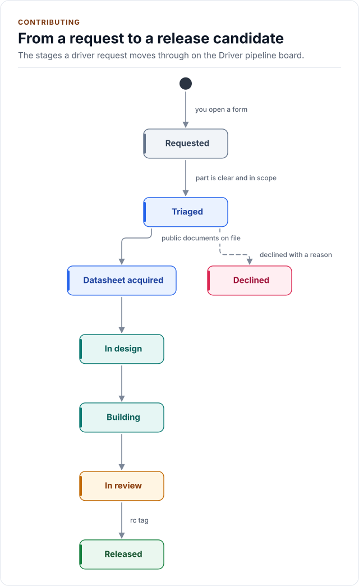

# Contributing

## Good first contributions

| You can | Where |
| --- | --- |
| Fix a doc, a typo or a broken example | Any repository; the docs live in `docs/` |
| Ask for a driver, or say which chip you need most | [Request a driver](#request-a-driver) |
| Add a vote to a request you also need | A thumbs-up reaction on that request's issue |
| Run a driver on a real chip and report what you saw | The driver's repository; see [hardware validation](principles.md#hardware-validation-levels) |
| Report that a chip does not do what its datasheet says | The [datasheet erratum form](https://github.com/kokeb-labs-drivers/driver-requests/issues/new?template=datasheet-erratum.yml) |
| Write a driver for a chip you know | Start from [`driver-template`](https://github.com/kokeb-labs/driver-template) and open a [discussion](https://github.com/kokeb-labs/.github/discussions) first |
| Ask for a port to an MCU family, SDK or RTOS | The [port request form](https://github.com/kokeb-labs-drivers/driver-requests/issues/new?template=request-port.yml) |
| Report a bug | The repository's issues, with the bug form |

Issues labelled **good first issue** are a good start.

## Request a driver

A driver is written only from public documents, so a request is a form with a link. Search the
[open and closed requests](https://github.com/kokeb-labs-drivers/driver-requests/issues?q=is%3Aissue) first; if the
chip is already there, add a thumbs-up reaction. That is the vote.

| I want to | Open |
| --- | --- |
| A driver for a chip that has none | [Request a driver](https://github.com/kokeb-labs-drivers/driver-requests/issues/new?template=request-driver.yml) |
| The drivers on an MCU family, SDK or RTOS without a port | [Request a port or target](https://github.com/kokeb-labs-drivers/driver-requests/issues/new?template=request-port.yml) |
| Report a datasheet erratum | [Datasheet erratum](https://github.com/kokeb-labs-drivers/driver-requests/issues/new?template=datasheet-erratum.yml) |

<!-- figure: request-pipeline -->
<picture>
  <source media="(prefers-color-scheme: dark)" srcset="diagrams/request-pipeline.dark.svg">
  
</picture>
<!-- /figure -->

Every request sits on the **Driver pipeline** board of the drivers organisation, and its *Stage* shows where it is.
When you open or edit a request, a triage workflow reads your part number, labels the issue `chip:<PART>`, lists
duplicates and existing drivers that may cover the part, and labels `needs-datasheet` or `needs-info` when something
is missing. Editing the issue runs the check again.

The datasheet link must be an `https` link on the **chip vendor's own website**, reachable without an account, and a
link, never an attachment. Never link a document under NDA.

The queue is ordered by votes, how complete the public documents are, effort (simpler chips go first) and help
offered: someone who can test on hardware or review moves a request up. A request may be declined when the documents
are not public, the part is obsolete, or it is a module whose firmware already hides the chip. The reason is always
given in a comment. The [request repository](https://github.com/kokeb-labs-drivers/driver-requests) has every
detail.

## How a change gets in

1. Fork the repository and create a branch.
2. Make the change, with its docs and tests in the same pull request.
3. Sign off every commit: `git commit -s`. CI fails a pull request with a commit that has no matching
   `Signed-off-by:` line.
4. Open the pull request. `CI gate` runs every check and tells you what is missing; a maintainer reviews.

Workflows from a first-time contributor's fork wait for a maintainer's approval before they run. If a change affects
behaviour on hardware, say in the pull request which MCU and board you ran it on and what you observed, or write
"not verified on hardware" with the steps someone should run.

## Security

Report a vulnerability privately through the repository's **Security** tab ("Report a vulnerability"), never in a
public issue. The [security policy](https://github.com/kokeb-labs/.github/blob/main/SECURITY.md) says what happens
next.

## Community

Be kind and specific: the [code of conduct](https://github.com/kokeb-labs/.github/blob/main/CODE_OF_CONDUCT.md)
applies everywhere. Full details are in the
[contributing guide](https://github.com/kokeb-labs/.github/blob/main/CONTRIBUTING.md). Questions and ideas go to
[Discussions](https://github.com/kokeb-labs/.github/discussions); anything else to <kokeblabs@gmail.com>.
