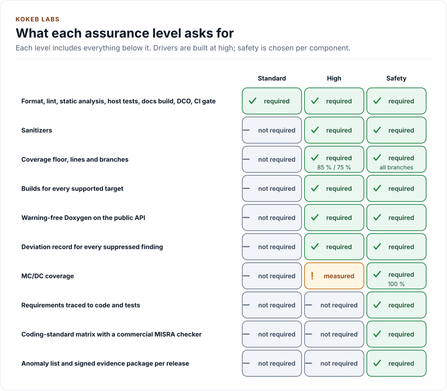
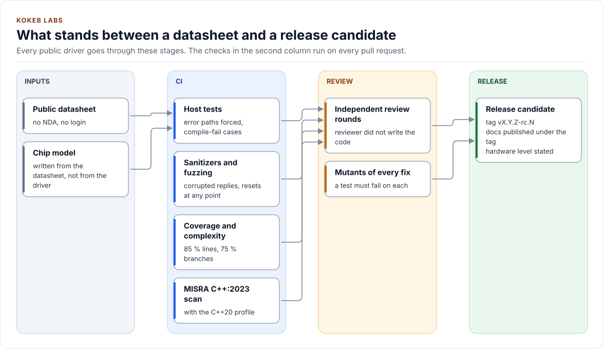
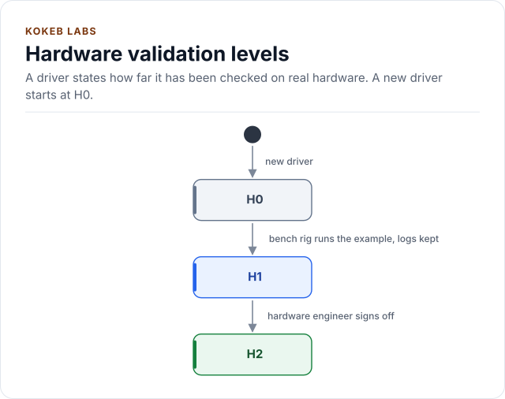
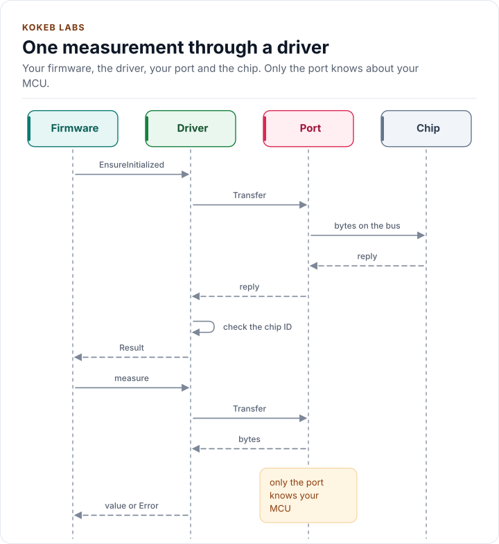
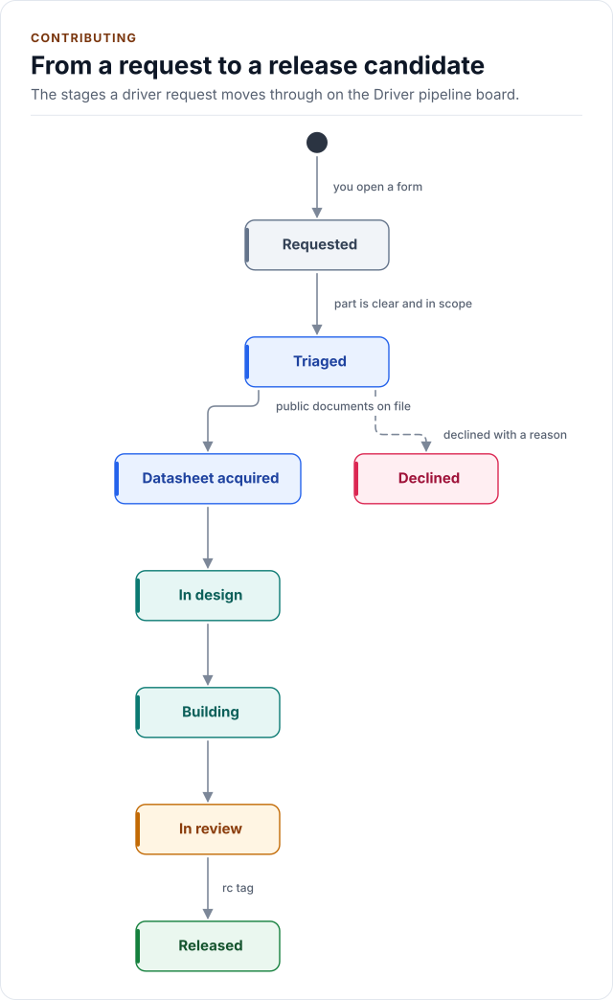
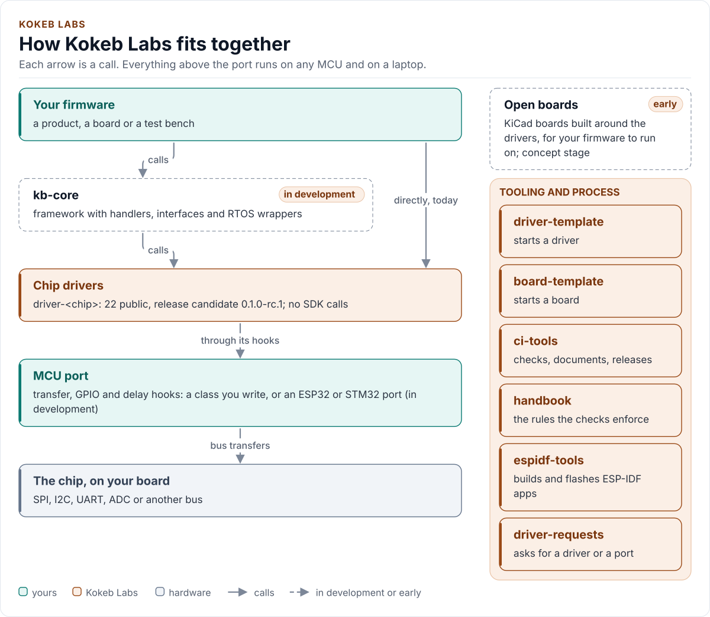

# Figures

<!-- Written by kokeb-docs figures from docs/diagrams/figures/*.py. Do not edit by hand. -->

Every figure on this site is drawn by a Python module from facts extracted from the code, so it is rebuilt,
not redrawn, when the code changes. CI runs `kokeb-docs figures --check` and fails when a
committed figure no longer matches the code. Each figure below lists the files it is drawn from.

## What each assurance level asks for

<!-- figure: assurance-levels -->
<picture>
  <source media="(prefers-color-scheme: dark)" srcset="assurance-levels.dark.svg">
  
</picture>
<!-- /figure -->

Hardware description: [`docs/model/assurance-levels.matrix.yml`](../model/assurance-levels.matrix.yml)

Drawn from:

- [`docs/model/assurance-levels.matrix.yml`](../model/assurance-levels.matrix.yml)

## What stands between a datasheet and a release candidate

<!-- figure: driver-gates -->
<picture>
  <source media="(prefers-color-scheme: dark)" srcset="driver-gates.dark.svg">
  
</picture>
<!-- /figure -->

Hardware description: [`docs/model/driver-gates.pipeline.yml`](../model/driver-gates.pipeline.yml)

Drawn from:

- [`docs/model/driver-gates.pipeline.yml`](../model/driver-gates.pipeline.yml)

## Hardware validation levels

<!-- figure: hardware-levels -->
<picture>
  <source media="(prefers-color-scheme: dark)" srcset="hardware-levels.dark.svg">
  
</picture>
<!-- /figure -->

Hardware description: [`docs/model/hardware-levels.state.yml`](../model/hardware-levels.state.yml)

Drawn from:

- [`docs/model/hardware-levels.state.yml`](../model/hardware-levels.state.yml)

## One measurement through a driver

<!-- figure: one-measurement -->
<picture>
  <source media="(prefers-color-scheme: dark)" srcset="one-measurement.dark.svg">
  
</picture>
<!-- /figure -->

Hardware description: [`docs/model/one-measurement.seq.yml`](../model/one-measurement.seq.yml)

Drawn from:

- [`docs/model/one-measurement.seq.yml`](../model/one-measurement.seq.yml)

## From a request to a release candidate

<!-- figure: request-pipeline -->
<picture>
  <source media="(prefers-color-scheme: dark)" srcset="request-pipeline.dark.svg">
  
</picture>
<!-- /figure -->

Hardware description: [`docs/model/request-pipeline.state.yml`](../model/request-pipeline.state.yml)

Drawn from:

- [`docs/model/request-pipeline.state.yml`](../model/request-pipeline.state.yml)

## How Kokeb Labs fits together

<!-- figure: system-map -->
<picture>
  <source media="(prefers-color-scheme: dark)" srcset="system-map.dark.svg">
  
</picture>
<!-- /figure -->

Figure module: [`docs/diagrams/figures/system-map.py`](../../docs/diagrams/figures/system-map.py)
