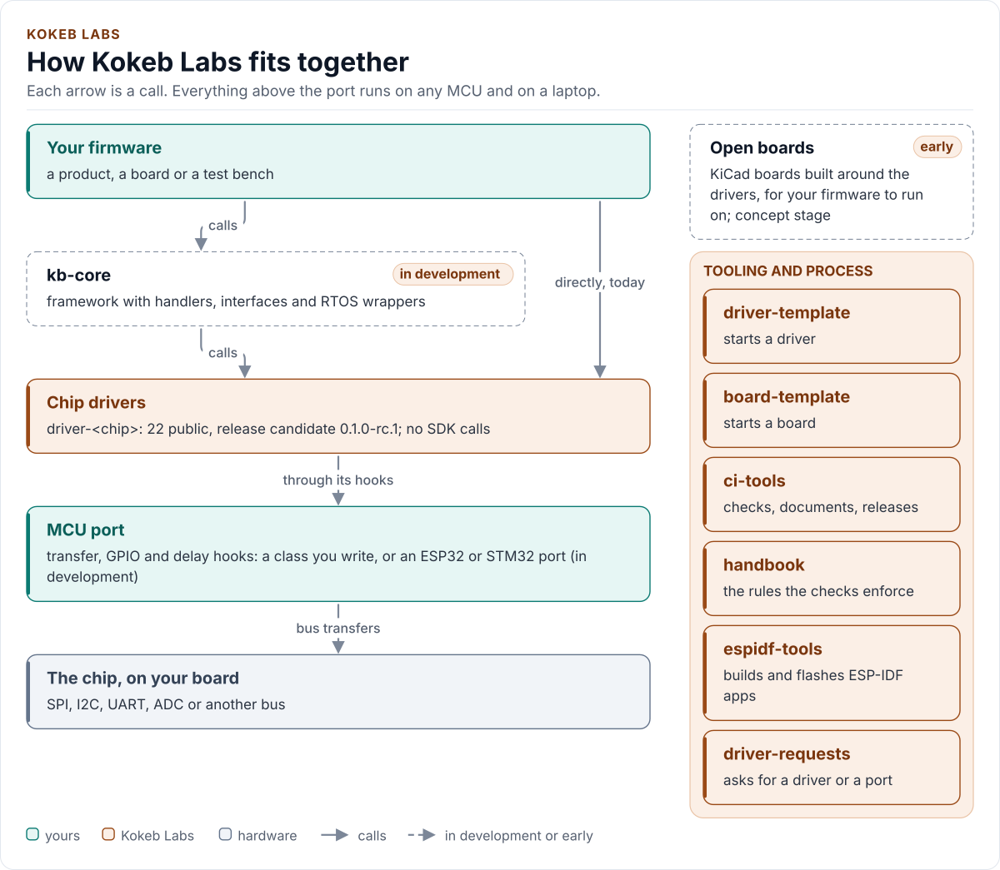
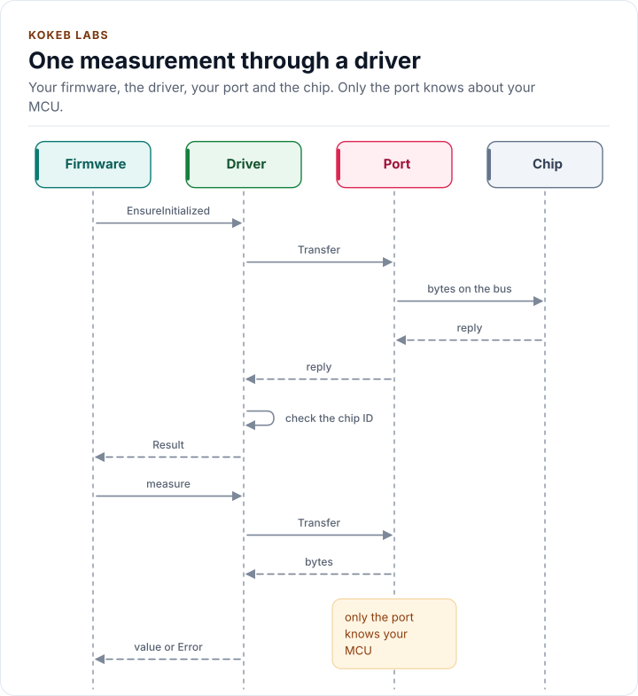

<div class="kb-hero" markdown>
<span class="kb-kicker">Open-source embedded C++</span>

# Write the driver once. Run it on any MCU.

<p>Kokeb Labs builds the software between your firmware and the chips on your board: C++20 drivers that never call
a vendor SDK, a framework that joins them, and the tools and process that keep them trustworthy. You give a driver a
few small functions for your bus, and the same code runs on ESP32, STM32, RP2040 or your laptop, where its tests
run without hardware. MIT licensed.</p>

[Browse the drivers](projects.md#chip-drivers){ .md-button .md-button--primary }
[Request a driver](contributing.md#request-a-driver){ .md-button }
[GitHub](https://github.com/kokeb-labs){ .md-button }
</div>

## What Kokeb Labs is

*Kokeb (ኮከብ) means "star" in Amharic.* Kokeb Labs is one project with four parts:

<div class="grid cards" markdown>

- **Chip drivers**

    ---

    One public repository per chip, named `driver-<chip>`: 22 today, from ADCs, encoders and sensors to motor
    controllers and a CANopen client. Each is a header-only C++20 library with a datasheet-backed documentation site.

    [See the drivers](projects.md#chip-drivers)

- **Tooling and process**

    ---

    `driver-template` starts a driver in one command, `ci-tools` gives every repository the same checks, docs and
    releases, and `espidf-tools` builds ESP-IDF apps. The handbook holds the rules the checks enforce.

    [See the tooling](projects.md#tooling-and-process)

- **Open boards**

    ---

    KiCad boards built around the drivers, traced from needs to test results. A template, a parts library and a block
    library exist; the first board is at concept stage.

    [See the boards](projects.md#open-boards)

- **A framework, coming**

    ---

    `kb-core` joins drivers to ports and an RTOS layer, with ports for ESP32 and STM32. It is in development and not
    public yet. Drivers do not wait for it: they work on their own.

    [Read the roadmap](roadmap.md)

</div>

## How the pieces fit

<!-- figure: system-map -->
<picture>
  <source media="(prefers-color-scheme: dark)" srcset="diagrams/system-map.dark.svg">
  
</picture>
<!-- /figure -->

Your firmware calls a driver. The driver knows the chip and nothing about your MCU: it reaches the bus only through
the hooks of a port class. Beside that path sits the tooling lane: the templates start a repository, `ci-tools` runs
the same checks in all of them, the handbook says what those checks enforce, and the request repository takes the
asks for new drivers.

## Why it's different

<div class="grid cards" markdown>

- **You write the port, not the driver**

    ---

    A driver needs a few functions from you: bring the bus up, move bytes, wait. A C++20 concept checks them at
    compile time, so a missing or wrong hook is a compile error, not a crash on the bench.

- **Tests before the board arrives**

    ---

    Every driver builds and runs its tests on the host against a model of the chip written from the datasheet. A
    fuzzer corrupts the chip's replies, and compile-fail tests prove the port contract rejects what it should.

- **Small and predictable**

    ---

    Every call returns `Result<T>` with an error code. No exceptions, no heap, no RTTI, no virtual calls, so it
    fits small MCUs and safety reviews.

- **Honest about status**

    ---

    Each driver states how far it has been checked on real hardware as a level, H0 to H2. All 22 are at H0 today:
    host-tested and fuzzed, not yet verified on a bench. Every README says so.

</div>

## What a port looks like

The whole MCU-specific part of an SPI driver, from [`driver-template`](https://github.com/kokeb-labs/driver-template).
Fill in the bodies with your SDK's calls:

```cpp
#include "xmpl100.hpp"

class MyPort : public xmpl100::SpiInterface<MyPort> {
 public:
  bool EnsureInitialized() noexcept;  // bring the bus up on the first call; true at once afterwards
  bool Transfer(const uint8_t* tx, uint8_t* rx, std::size_t len) noexcept;  // one transfer, CS held low
  void DelayUs(uint32_t us) noexcept;  // wait at least us microseconds
};
```

Then use the driver the same way on every board:

```cpp
xmpl100::XMPL100<MyPort> sensor(port);          // no I/O yet
if (auto r = sensor.EnsureInitialized(); !r) {  // bus up, reset, chip ID check
  return static_cast<int>(r.error);             // Bus, Timeout or DeviceIdMismatch
}
const auto t = sensor.ReadTemperatureC();       // t.value in degrees Celsius, or t.error
```

<!-- figure: one-measurement -->
<picture>
  <source media="(prefers-color-scheme: dark)" srcset="diagrams/one-measurement.dark.svg">
  
</picture>
<!-- /figure -->

## Built for firmware where a bug can hurt

The process is written for software that may end up in a safety-classified product: MISRA C++:2023 checks on every
pull request, an independent review of each driver, fuzzing, coverage gates, release candidates before releases and a
stated hardware validation level. A Kokeb component is not a certified product; it supplies the evidence a
manufacturer's own process asks for.

[Read how we build](principles.md){ .md-button }

## Where to start

<div class="grid cards" markdown>

- **I want to use a driver**

    ---

    Pick the chip, read its quickstart, write the port class for your SDK. Each driver has a host example you can run
    on your PC first.

    [Driver list](projects.md#chip-drivers)

- **I need a driver that isn't here**

    ---

    Open a request with a link to the vendor's public datasheet. Votes, public documents and effort decide the order.

    [Request a driver](contributing.md#request-a-driver)

- **I want to write a driver**

    ---

    Create a repository from the template and run one command. Your first build and tests pass before you change a
    line.

    [Using the template](https://github.com/kokeb-labs/driver-template/blob/main/docs/template.md)

- **I want this CI in my repository**

    ---

    A few short caller workflows give you C++ checks, firmware builds, a docs site and releases.

    [ci-tools quickstart](https://kokeb-labs.github.io/ci-tools/latest/quickstart/)

</div>
