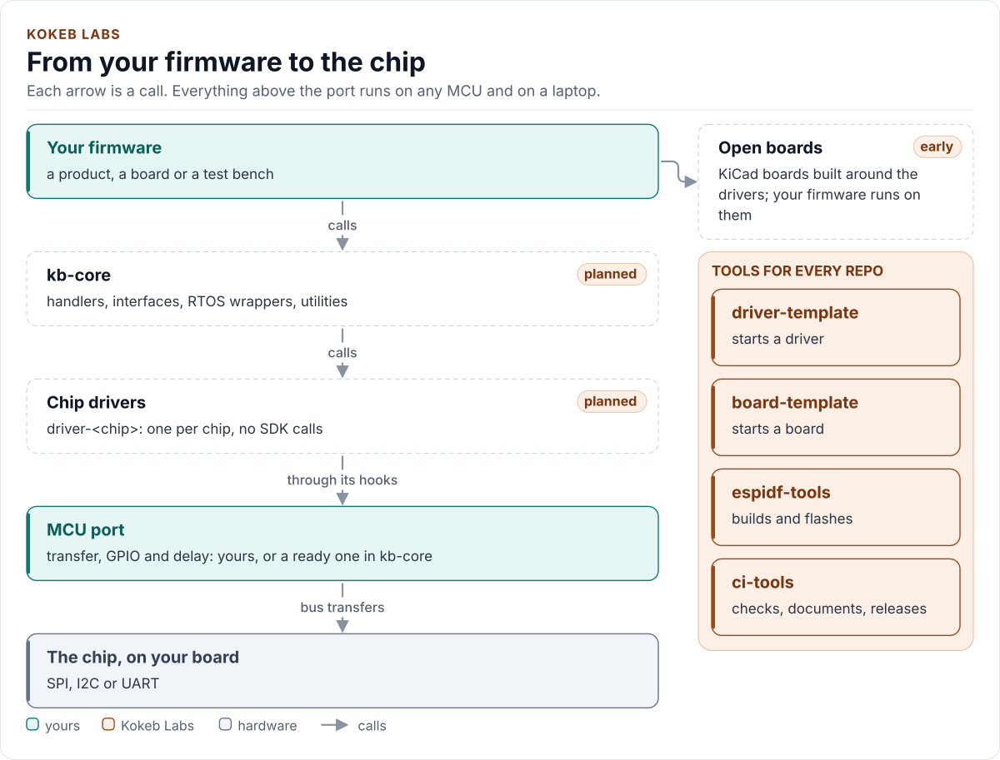

<div class="kb-hero" markdown>
<span class="kb-kicker">Open-source embedded C++</span>

# Write the driver once. Run it on any MCU.

<p>Chip drivers and firmware building blocks in C++20 that never call a vendor SDK. Give a driver two small
functions for your bus and the same code runs on ESP32, STM32, RP2040 or your laptop, where its tests run without
hardware. MIT licensed.</p>

[Start a driver](https://github.com/kokeb-labs/driver-template){ .md-button .md-button--primary }
[See what's here](projects.md){ .md-button }
[GitHub](https://github.com/kokeb-labs){ .md-button }
</div>

## Why it's different

<div class="grid cards" markdown>

- **You write the port, not the driver**

    ---

    A driver needs two functions from you: bring the bus up, and move bytes. A C++20 concept checks them at
    compile time, so a missing or wrong hook is a compile error, not a crash on the bench.

- **Tests before the board arrives**

    ---

    Every driver builds and runs its tests on the host against a simulated chip. Compile-fail tests prove the
    port contract rejects what it should.

- **Small and predictable**

    ---

    Every call returns `Result<T>` with an error code. No exceptions, no heap, no RTTI, no virtual calls, so it
    fits small MCUs and safety reviews.

</div>

Every repository also comes with the same documentation site, lint, static analysis, sign-off check and one
required check, from shared workflows pinned with `@v1`.

## What a port looks like

The whole MCU-specific part of an SPI driver, from [`driver-template`](https://github.com/kokeb-labs/driver-template).
Fill in the two bodies with your SDK's calls:

```cpp
#include "xmpl100.hpp"

class MyPort : public xmpl100::SpiInterface<MyPort> {
 public:
  bool EnsureInitialized() noexcept;  // bring the bus up on the first call; true at once afterwards
  bool Transfer(const uint8_t* tx, uint8_t* rx, std::size_t len) noexcept;  // one transfer, CS held low
};
```

Then use the driver the same way on every board:

```cpp
xmpl100::XMPL100<MyPort> sensor(port);   // no I/O yet
if (auto r = sensor.Initialize(); !r) {  // bus up, reset, chip ID check
  return static_cast<int>(r.error);      // Bus, Timeout or DeviceIdMismatch
}
const auto t = sensor.ReadTemperatureC();  // t.value in degrees Celsius, or t.error
```

<!-- figure: ecosystem -->
<picture>
  <source media="(prefers-color-scheme: dark)" srcset="diagrams/ecosystem.dark.svg">
  
</picture>
<!-- /figure -->

## Available today

| Project | What it does | Status |
| --- | --- | --- |
| [`driver-template`](https://github.com/kokeb-labs/driver-template) | `python3 tools/setup.py` turns it into a new SPI, I2C or UART driver, or a library: code, host tests, an ESP32 example, docs and CI | <span class="kb-badge kb-badge--teal">Ready</span> |
| [`espidf-tools`](https://kokeb-labs.github.io/espidf-tools/) | Build, flash and monitor every app of an ESP-IDF project across IDF versions and build types, from one `app_config.yml` | <span class="kb-badge kb-badge--teal">v1</span> |
| [`ci-tools`](https://kokeb-labs.github.io/ci-tools/) | Reusable GitHub Actions workflows and the documentation theme every repository uses | <span class="kb-badge kb-badge--teal">v1</span> |
| Chip drivers, `kb-core` | Drivers for real chips, and the shared interfaces, RTOS wrappers and handlers | <span class="kb-badge kb-badge--amber">Next</span> |

## Where to start

<div class="grid cards" markdown>

- **I want to write a driver**

    ---

    Create a repository from the template and run one command. Your first build and tests pass before you
    change a line.

    [Using the template](https://github.com/kokeb-labs/driver-template/blob/main/docs/template.md)

- **I build ESP-IDF firmware**

    ---

    List your apps once in `app_config.yml`; build, flash and monitor any of them, and build them all in CI.

    [espidf-tools quickstart](https://kokeb-labs.github.io/espidf-tools/latest/quickstart/)

- **I want this CI in my repository**

    ---

    A few short caller workflows give you C++ checks, firmware builds, a docs site and releases.

    [ci-tools quickstart](https://kokeb-labs.github.io/ci-tools/latest/quickstart/)

</div>

**Need a driver for a chip?** [Tell us which one](https://github.com/kokeb-labs/.github/issues/new?template=driver-request.yml)
and what you use it for; requests decide what comes next.

*Kokeb (ኮከብ) means "star" in Amharic.*
