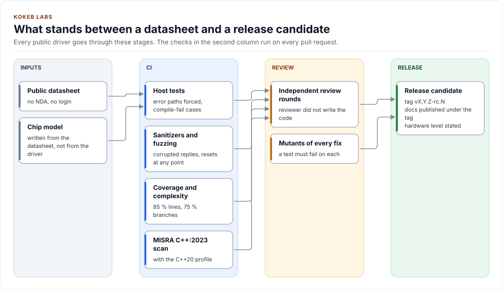
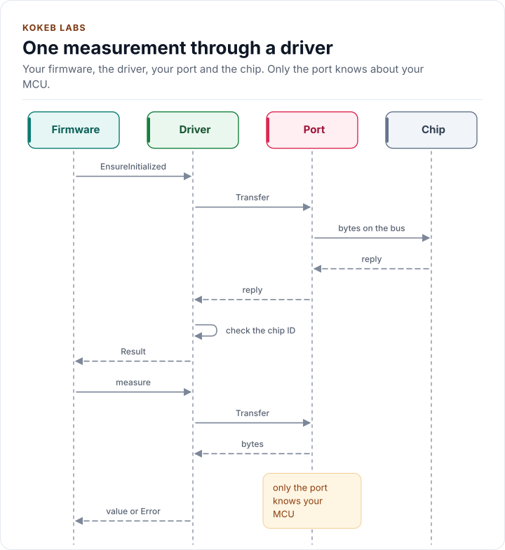
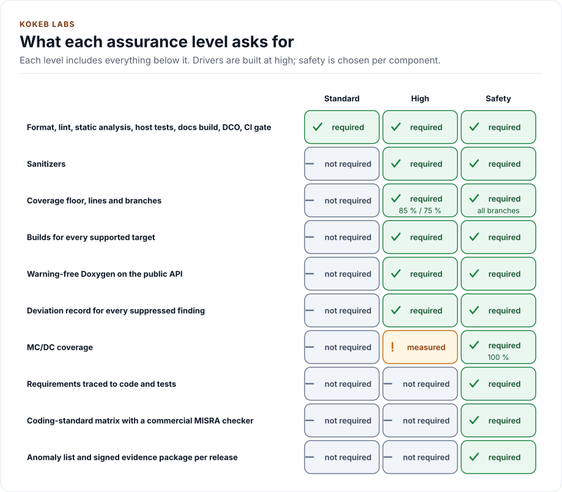
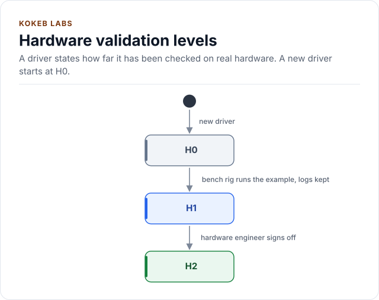

# How we build

A driver is the chip's datasheet turned into C++. We build each one as if it could end up in a safety-classified
product, and we say plainly how far each one has got.

## The process in one picture

<!-- figure: driver-gates -->
<picture>
  <source media="(prefers-color-scheme: dark)" srcset="diagrams/driver-gates.dark.svg">
  
</picture>
<!-- /figure -->

| Practice | What it means here |
| --- | --- |
| **Public datasheets only** | A driver is written from documents anyone can read. A chip whose register map is under NDA is declined |
| **IEC 62304, up to Class C** | The process maps onto the standard's clauses so a manufacturer can use a component in software of any safety class, Class C included. It is not a certificate: see [below](#using-a-component-in-a-medical-device) |
| **MISRA C++:2023** | Every pull request runs the MISRA scan; each deviation is recorded with its reason |
| **Independent review** | A reviewer who did not write the driver, its model or its tests reviews it, in rounds, until nothing is left |
| **Fuzzing** | A fuzzer corrupts and replaces what the chip sends back and resets the chip at any point, on every pull request |
| **Mutation testing** | Reviewers break each fix on purpose; a test must fail on every mutant |
| **Coverage and complexity gates** | 85 % lines and 75 % branches at least, and limits on function size and complexity |
| **Release candidates** | Every driver ships as a `-rc` tag first, with its hardware level stated in the release text |
| **Hardware validation levels** | H0, H1 and H2 say how far the driver has been checked on a real chip |

## A driver never touches the SDK

Everything that depends on your MCU sits behind a small port class that you write, and the driver only calls its
hooks.

| The driver owns | Your port owns |
| --- | --- |
| Register framing, reset and chip-ID checks, conversions, CRCs | Bringing the bus up, moving bytes, optional GPIO, delay and log hooks |
| Units, ranges and `Config` presets with datasheet defaults | Pins, clocks, DMA, locking, which SPI or I2C peripheral |

The port derives from the driver's interface with CRTP (`class MyPort : public chip::SpiInterface<MyPort>`) and a
C++20 concept checks every required hook at compile time. There are no virtual calls, so the compiler can inline the
port into the driver.

## Predictable on small MCUs

- **No exceptions, no heap, no RTTI.** Every call returns `Result<T>`: a value, or an `Error` that says what went
  wrong (`Bus`, `Timeout`, `DeviceIdMismatch`, chip-specific faults).
- **Nothing happens in a constructor.** `EnsureInitialized()` does the first I/O, so you decide when the bus is
  touched.
- **Bounded waits.** A driver never blocks forever on a busy flag.
- **No reading it can't trust.** A driver reports a bad reading as an `Error`, not as a measurement: the BMP581
  driver, for one, refuses a stuck line, a reset value and anything outside the measurement range.

## Brand-free

A driver is named after its chip, not after a product: repository `driver-<chip>`, namespace `<chip>::`. A product's
pin map or modes never go into a shared repository.

| Kind of "specific" | Example | Where it lives |
| --- | --- | --- |
| Chip-specific | the registers of one sensor | that chip's driver |
| MCU-specific | an ESP-IDF SPI port | a port, built only for that family |
| Product-specific | one product's pin map or modes | the product's own repository, through extension points |

## Tested without hardware

Every driver builds and runs its tests on the host with CMake and `ctest`. The chip model is written from the
datasheet, not from the driver, so a wrong constant in the driver can't hide behind the same wrong constant in the
model. The model changes state on its own, resets mid-session and completes measurements in time, so a missed reset
fails a test.

- Error paths are forced: every bus transfer fails in turn, and every error the driver can return is produced.
- Compile-fail tests check that a broken port does not compile.
- A fuzzer (libFuzzer with the address and undefined-behaviour sanitizers, 120 s per target on every pull request)
  corrupts the replies and checks that no broken line is returned as data. Every input that ever broke a promise stays
  in the replayed corpus, so a fixed bug stays fixed.

<!-- figure: one-measurement -->
<picture>
  <source media="(prefers-color-scheme: dark)" srcset="diagrams/one-measurement.dark.svg">
  
</picture>
<!-- /figure -->

## Coding standards

| Standard | Used for |
| --- | --- |
| **MISRA C++:2023** with Technical Corrigendum 1 (2026) | C++ code. Every guideline is classified in a compliance matrix: decided by a tool, checked in review, left to a commercial checker, or not applicable with a reason |
| **MISRA C:2025** | C code; its matrix follows the same format |
| **SEI CERT C++ and C** | Security baseline, checked by clang-tidy and cppcheck |
| **C++ Core Guidelines** | Design and idiom, through clang-tidy |
| **NASA/JPL Power of Ten** | Embedded discipline |

We follow the approach MISRA itself defines in *MISRA Compliance:2020*: an enforcement plan, a re-categorisation plan
where our profile is stricter, a deviation record for every departure from a required guideline, and a compliance
summary with each release. Mandatory guidelines are never deviated. Every pull request runs the MISRA scan with the
open CodeQL coding-standards pack on a host and a Cortex-M build; the commercial checker is added at the
[safety level](#assurance-levels).

## Independent review

A review round is one independent reviewer, one fixer and one verdict, repeated until the stop rule holds.

- The reviewer did not write the driver, its model or its tests, works read-only, and never sees the builder's
  conclusions.
- Mechanical results come first: lint, the gate log and the CI lines are not re-argued.
- The reviewer verifies the previous round's fixes at the cause by building **mutants**: revert the fix, or change a
  constant in its guard. A fix is accepted only if a test fails on its mutant.
- Every claim in the docs and the build report ("never", "always", "returns") is checked against the code and a test.
- The judgement questions go to the reviewer: is the datasheet read correctly, is the state machine complete, is the
  model independent of the driver.

Anything a script can decide moves out of review into lint or a test, so reviewers spend their time on judgement.

## Assurance levels

Not every repository needs the same rigour. Each declares one of three levels, and each includes the one below it.

<!-- figure: assurance-levels -->
<picture>
  <source media="(prefers-color-scheme: dark)" srcset="diagrams/assurance-levels.dark.svg">
  
</picture>
<!-- /figure -->

Drivers are built at **high** from their first release. **Safety** is chosen per component, when a product team
intends to qualify it, and commits the project to keeping the evidence current for every release.

### Using a component in a medical device

IEC 62304 applies to a manufacturer's process, not to a library. A manufacturer can use a Kokeb component as SOUP
(software of unknown provenance), or bring it under their own process by forking it at a release. The
[handbook's IEC 62304 page](https://kokeb-labs.github.io/handbook/iec-62304/) maps each clause of the standard onto
what a component provides. A component at the safety level is not "IEC 62304 compliant": risk management, hazard
analysis, system testing and the device's technical file stay with the manufacturer.

## Releases and release candidates

1. The driver is built and reviewed until the full local rehearsal of CI passes.
2. It is published in a public repository, and `main` must be green with its docs published.
3. The first tag is a release candidate, `vX.Y.Z-rc.1`. Its release text states the hardware level. A release
   candidate publishes its docs under its own tag and does not move `latest`.
4. A release candidate that passes the bench is tagged again, on the same commit, as `vX.Y.Z`.

All 22 public drivers are at `v0.1.0-rc.1` today.

## Hardware validation levels

Tests prove the driver against a model of the chip written from the datasheet. A bench proves the model. Each driver
states how far it has been checked as a level, in its metadata and as a badge on its README.

<!-- figure: hardware-levels -->
<picture>
  <source media="(prefers-color-scheme: dark)" srcset="diagrams/hardware-levels.dark.svg">
  
</picture>
<!-- /figure -->

| Level | Means |
| --- | --- |
| **H0** | Host model only: never run on a chip. Releases say **not hardware-verified** |
| **H1** | A defined bench rig ran the example; the rig document and the logs are kept |
| **H2** | A hardware engineer reviewed the rig and the steps and signed off |

Every public driver is at H0 today. We don't call a driver verified without the evidence for H1 or H2.

## Language standard

**Drivers target C++20 today.** One language level across every repository lets any driver sit under any library.
C++20 gives concepts for the port contract, `requires` for optional hooks, `std::span` for caller buffers and
designated initialisers for configuration, and it is supported by ESP-IDF 5.x and current STM32 toolchains without
the lag that C++23 has on vendor compilers.

- **It is checked, not assumed.** Every target builds as ISO C++20 with compiler extensions off and
  `-pedantic-errors`, and every public header also compiles on its own at `-std=c++20` with each compiler the
  repository ships for. ESP-IDF's own default dialect is newer, so without that check a C++23 feature would compile
  on one toolchain and break on another.
- **It is a profile, not "anything in C++20".** MISRA C++:2023 is written for C++17, so the handbook's
  [C++20 profile](https://kokeb-labs.github.io/handbook/standards/cpp20-profile/) sorts the features into use, use
  with rules and forbid: 58 guidelines (4 mandatory, 36 required, 18 advisory). Anything from C++23 or later is a
  violation even where the compiler accepts it.
- **It is recorded.** A driver states its standard in its README badge and its build settings
  (`cxx_std_20`). Raising the compiler a caller needs is a breaking change, so a release that does it lists it under
  *Breaking* in its changelog.

**It will move up.** There is no date, and a move is not a surprise. It happens when all of these hold:

| Condition | Why |
| --- | --- |
| Every compiler we ship for supports the standard: the ESP-IDF toolchain, the CI compilers and the Cortex-M toolchain | A language level that one target can't build is not a level |
| The C++20 profile and its MISRA mapping are extended to it, in one pull request with the rule list and the deviation record | The coding standard fixes the language standard, so the checks must know the new one first |
| A decision record replaces ADR-0010 | A rule is not loosened or changed without a recorded reason |
| The release that adopts it lists the new compiler requirement as breaking | Callers choose when to move |

## The same checks in every repository

| Check | What it catches |
| --- | --- |
| Strict docs build, link check, figure and generated-table drift | Broken links, stale diagrams, docs that disagree with the code |
| Host build and tests, clang-tidy, cppcheck | Bugs, undefined behaviour, the port contract |
| clang-format, markdownlint, yamllint | Style drift |
| DCO sign-off, required files, MIT licence | Provenance and licensing |
| The handbook check | Rules with an ID, run as code |
| `CI gate` | One required check that passes only when everything else did |

The rules are in the [handbook](https://kokeb-labs.github.io/handbook/). Every rule has an ID, a level and the check
that verifies it.

## Supply-chain hygiene

Every third-party GitHub Action is pinned to a commit SHA on a real release tag and reviewed before it is allowed
in the organisation; tools without a trusted action are downloaded from their own release and checked against a
pinned SHA-256. Dependabot keeps the pins current. Secret scanning with push protection, Dependabot alerts and
CodeQL are on for every repository.

## Licence and sign-off

Everything is MIT licensed, `Copyright (c) 2026 The Kokeb Labs Authors`. There is no CLA: you sign off each commit
(`git commit -s`) to certify the [Developer Certificate of Origin](https://developercertificate.org/).
