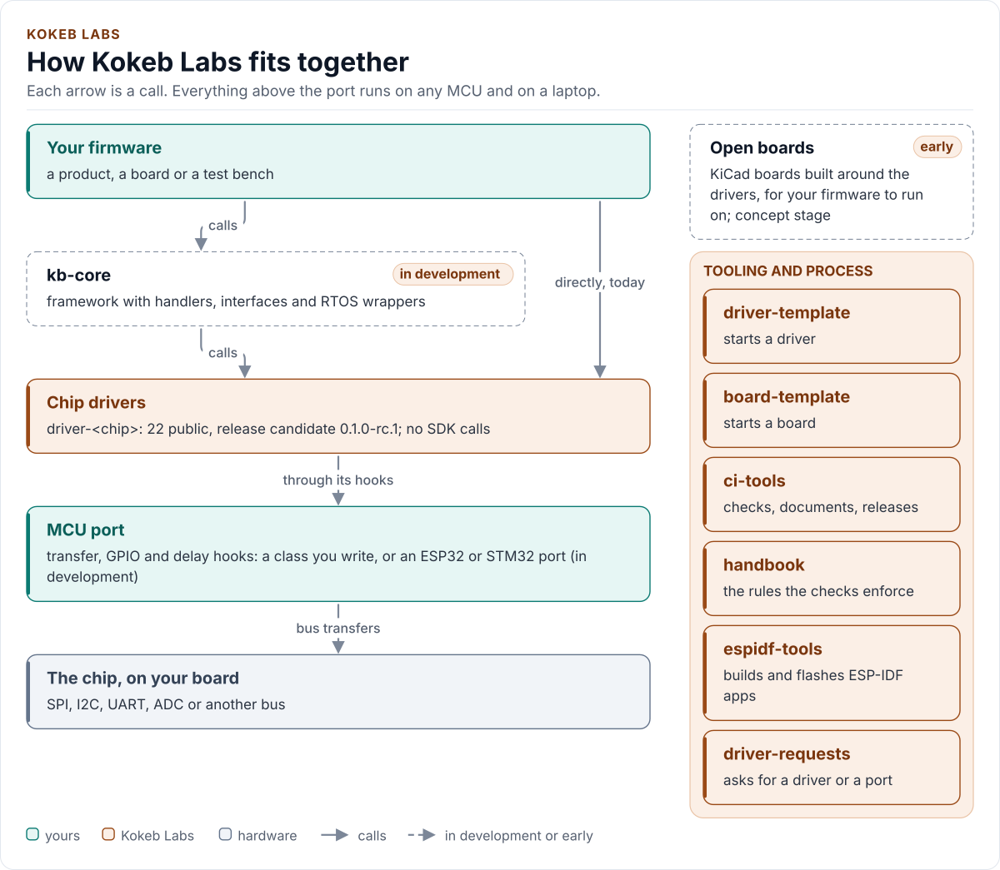

# Projects

Every public repository is MIT licensed and checked by the same CI: a strict docs build, lint, the DCO sign-off and
one required check, `CI gate`. They live in three GitHub organisations:

| Organisation | Holds |
| --- | --- |
| [kokeb-labs](https://github.com/kokeb-labs) | The tooling and process: templates, CI, the handbook, the engineering standard, this portal |
| [kokeb-labs-drivers](https://github.com/kokeb-labs-drivers) | The chip drivers and the driver request pipeline |
| [kokeb-labs-open-boards](https://github.com/kokeb-labs-open-boards) | Open boards, their KiCad parts library and circuit blocks |

<!-- figure: system-map -->
<picture>
  <source media="(prefers-color-scheme: dark)" srcset="diagrams/system-map.dark.svg">
  
</picture>
<!-- /figure -->

## Chip drivers Release candidates { #chip-drivers }

**One repository per chip, named `driver-<chip>`.** Each driver is a header-only C++20 library with no SDK calls: you
write a short port class for your bus and the driver does the rest. Each has a host example that runs on your PC, an
ESP32 example, a documentation site built from the datasheet, and a Doxygen API reference.

Today there are 22, all tagged `v0.1.0-rc.1`. That is a release candidate: host-tested against a model of the chip,
fuzzed and MISRA-checked, **not yet verified on hardware** (level H0, see [how we build](principles.md#hardware-validation-levels)).

| Driver | Chip | Bus |
| --- | --- | --- |
| [`driver-ads7952`](https://kokeb-labs-drivers.github.io/driver-ads7952/) | TI ADS7950, ADS7951, ADS7952 and ADS7953 12-bit ADCs with 4, 8, 12 or 16 channels | SPI |
| [`driver-ads9324`](https://kokeb-labs-drivers.github.io/driver-ads9324/) | TI ADS9324 16-channel, 16-bit, 1 MSPS simultaneous-sampling ADC | SPI |
| [`driver-alicat-basis2`](https://kokeb-labs-drivers.github.io/driver-alicat-basis2/) | Alicat BASIS 2 gas mass flow meters and controllers (B and BC series) | Serial (ASCII protocol), Modbus RTU |
| [`driver-as5047u`](https://kokeb-labs-drivers.github.io/driver-as5047u/) | ams OSRAM AS5047U 14-bit magnetic rotary position sensor | SPI |
| [`driver-at25040b`](https://kokeb-labs-drivers.github.io/driver-at25040b/) | Microchip AT25010B, AT25020B and AT25040B serial EEPROMs | SPI |
| [`driver-bmp581`](https://kokeb-labs-drivers.github.io/driver-bmp581/) | Bosch BMP581 barometric pressure and temperature sensor | I2C, SPI |
| [`driver-bno08x`](https://kokeb-labs-drivers.github.io/driver-bno08x/) | Hillcrest Labs and CEVA BNO08x 9-axis orientation sensors | I2C, SPI, UART |
| [`driver-canopen-client`](https://kokeb-labs-drivers.github.io/driver-canopen-client/) | CANopen client: NMT master, SDO, heartbeat, EMCY, PDO and a CiA 402 drive state machine | CAN frame port |
| [`driver-dynamixel`](https://kokeb-labs-drivers.github.io/driver-dynamixel/) | ROBOTIS DYNAMIXEL servos, protocols 1.0 and 2.0 | Half-duplex UART |
| [`driver-fdo2`](https://kokeb-labs-drivers.github.io/driver-fdo2/) | PyroScience FDO2 optical oxygen sensor modules | UART |
| [`driver-isf15acp4`](https://kokeb-labs-drivers.github.io/driver-isf15acp4/) | NKK SmartDisplay OLED pushbuttons and displays (ISF15ACP4, ISC15ANP4, ISC01P) | SPI |
| [`driver-max22200`](https://kokeb-labs-drivers.github.io/driver-max22200/) | Analog Devices MAX22200 octal solenoid and motor driver | SPI |
| [`driver-mcp9700`](https://kokeb-labs-drivers.github.io/driver-mcp9700/) | Microchip MCP9700, MCP9700A, MCP9701 and MCP9701A analog temperature sensors | ADC |
| [`driver-ntc-thermistor`](https://kokeb-labs-drivers.github.io/driver-ntc-thermistor/) | NTC thermistors on an ADC, any part: B-parameter, Steinhart-Hart and lookup tables | ADC |
| [`driver-pca9685`](https://kokeb-labs-drivers.github.io/driver-pca9685/) | NXP PCA9685 16-channel 12-bit PWM controller | I2C |
| [`driver-pcal9555`](https://kokeb-labs-drivers.github.io/driver-pcal9555/) | NXP PCA9555 and PCAL9555A 16-bit GPIO expanders | I2C |
| [`driver-pf1550`](https://kokeb-labs-drivers.github.io/driver-pf1550/) | NXP PF1550 power management IC: Li-ion charger, three bucks, three LDOs | I2C |
| [`driver-sfm-flow-meter`](https://kokeb-labs-drivers.github.io/driver-sfm-flow-meter/) | Sensirion SFM family mass flow meters, SFM3000 to SFM6000D | I2C |
| [`driver-tle92466ed`](https://kokeb-labs-drivers.github.io/driver-tle92466ed/) | Infineon TLE92466ED six-channel low-side solenoid driver | SPI |
| [`driver-tmc5160`](https://kokeb-labs-drivers.github.io/driver-tmc5160/) | Trinamic TMC5160 and TMC5160A stepper motor controller and driver | SPI, UART |
| [`driver-tmc9660`](https://kokeb-labs-drivers.github.io/driver-tmc9660/) | TMC9660 servo controller and gate driver | SPI, UART |
| [`driver-ws2812-rmt`](https://kokeb-labs-drivers.github.io/driver-ws2812-rmt/) | Single-wire addressable RGB and RGBW LEDs (WS2812, SK6812 and compatible), ESP32 RMT port | Timed bit stream |

Related repositories:

- [`driver-requests`](https://github.com/kokeb-labs-drivers/driver-requests) is where you ask for a driver, a port or
  a new MCU target, or report a datasheet erratum. See [the request flow](contributing.md#request-a-driver).
- [`kokeb-labs-drivers/.github`](https://github.com/kokeb-labs-drivers/.github) holds the organisation profile and
  community files.

## Tooling and process

### driver-template Ready

**Start a new chip driver or library in one command.** Create a repository from the template, run
`python3 tools/setup.py`, answer a few questions (chip name, bus, description), and you get:

- A C++20 driver skeleton for an SPI, I2C or UART chip, or a header-only library, with the port contract checked
  by a concept at compile time.
- Host tests against a simulated chip, compile-fail tests for the port contract, a fuzz target and the quality gates.
- A host example that runs on your PC, and an ESP32 example built by `espidf-tools`.
- A documentation site with the chip's pinout, block, wiring and frame figures drawn from one `hardware.yml`, and the
  full CI.

[Repository](https://github.com/kokeb-labs/driver-template){ .md-button .md-button--primary }
[Using the template](https://github.com/kokeb-labs/driver-template/blob/main/docs/template.md){ .md-button }

### ci-tools v1

**The CI and documentation platform every repository uses.** Short caller workflows pin `@v1` and get fixes
without breaking changes.

- C++ build and host tests, clang-format, clang-tidy and cppcheck over one compile database.
- The MISRA C++:2023 scan, mutation testing, ESP-IDF firmware builds across versions with a size report, and
  releases that ship the exact firmware CI built.
- The documentation theme and figure kit used on this site: light and dark from one layout, contrast-checked, and
  redrawn from a model or the code so a figure can't go stale.
- Every third-party action pinned to a commit SHA and reviewed before it is allowed.

[Documentation](https://kokeb-labs.github.io/ci-tools/){ .md-button .md-button--primary }
[Repository](https://github.com/kokeb-labs/ci-tools){ .md-button }

### handbook Ready

**Every rule for C, C++, CMake, tests, docs, Git, CI and coding agents, with the check that verifies it.** A rule
has an ID, a level and a named way of being checked. The handbook also holds the C++20 profile, the MISRA C++:2023
compliance matrix, the assurance levels and the page on using a component under IEC 62304.

[Handbook](https://kokeb-labs.github.io/handbook/){ .md-button .md-button--primary }
[Repository](https://github.com/kokeb-labs/handbook){ .md-button }

### espidf-tools v1

**Build, flash and monitor every app of a multi-app ESP-IDF project.** List the apps, ESP-IDF versions, build types
and target once in `app_config.yml`; the same scripts run on your machine and in CI.

- `build_app.sh` and `flash_app.sh` for any app, build type and ESP-IDF version, each built into its own folder.
- `manage_idf.sh` installs and switches ESP-IDF versions; serial-port detection, logs and tab completion included.
- `generate_matrix.py` turns `app_config.yml` into a CI matrix, so CI builds exactly what you build locally.

[Documentation](https://kokeb-labs.github.io/espidf-tools/){ .md-button .md-button--primary }
[Repository](https://github.com/kokeb-labs/espidf-tools){ .md-button }

### .github

The organisation's profile, community files (contributing, code of conduct, security policy), the brand, the
engineering standard and the settings of every repository kept as code.

[Repository](https://github.com/kokeb-labs/.github){ .md-button }

## Open boards

Boards are built around the drivers and traced from what people need down to the part and its test results. All of
them are early: nothing has been manufactured or verified on hardware yet.

### board-template Version 0

**Start a new board in one command.** Create a repository from the template, run `python3 tools/setup.py`, and you
get:

- A board record (`board.yml`) with the status, the revision, the intended use and the drivers the board is built
  around.
- A requirements trace: needs, requirements, risks and verifications as data, linked by the version of what they
  derive from, so a change to a need or a chip flags everything that depends on it.
- A check that fails CI on broken or suspect links, unverified requirements and missing evidence, with its tests.
- Folders and rules for the KiCad project, the enclosure, the firmware, the manufacturing package and the test
  results, and the outline of the evidence pack a release carries.

[Repository](https://github.com/kokeb-labs/board-template){ .md-button .md-button--primary }

### The boards organisation Concept

| Repository | What it is | Status |
| --- | --- | --- |
| [`board-bmp581-breakout`](https://github.com/kokeb-labs-open-boards/board-bmp581-breakout) | The first board: a breakout for the Bosch BMP581 pressure sensor, built around `driver-bmp581` | Concept: nothing built or verified |
| [`kokeb-libs`](https://github.com/kokeb-labs-open-boards/kokeb-libs) | KiCad symbols, footprints and 3D models, each with a review status and a datasheet reference | Concept: record format and checker exist, no library files yet |
| [`kokeb-blocks`](https://github.com/kokeb-labs-open-boards/kokeb-blocks) | Reusable circuit blocks (power, interfaces, sensor front ends) that boards are assembled from | Concept: record format and checker exist, no blocks yet |

## In development Not public yet

- **kb-core**, the framework: interface concepts, handlers that join drivers to them, small RTOS wrappers and
  utilities, with chip drivers pinned as release tags. Pick your MCU, RTOS and drivers in one CMake file; only what
  you pick is built.
- **MCU ports** for ESP32 and STM32: ready-made implementations of the bus, GPIO, timer and RTOS interfaces that
  drivers and handlers bind to.

These repositories are private while they are in development. Drivers do not depend on them: a driver works with
a port class you write yourself, and that stays true. See the [roadmap](roadmap.md).
